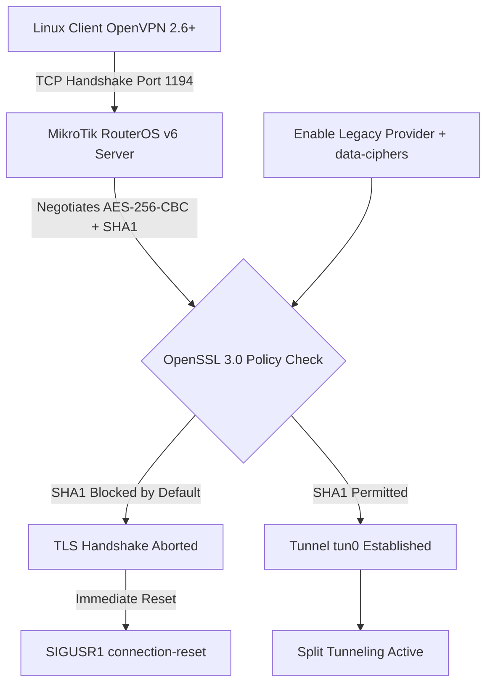

# Case Study: Resolving OpenVPN Legacy Cipher Handshake Resets on Modern Linux Clients

## 1. Executive Summary
A cross-platform VPN connectivity issue occurred when migrating administrative workstation operations from Windows to Linux (Xubuntu / Ubuntu-based). While existing `.ovpn` client profiles connected normally on Windows, Linux clients experienced immediate TCP connection resets during TLS negotiation. This document outlines the cryptographic root cause analysis, non-disruptive client-side remediation, and split-tunneling optimization.

---

## 2. Problem Statement & Symptoms
- **Environment:**
  - **VPN Server:** MikroTik RouterOS v6 (OpenVPN Server over TCP/1194)
  - **Client OS:** Xubuntu Linux (OpenSSL 3.x, OpenVPN 2.6+, NetworkManager)
- **Symptoms:**
  - Layer-4 TCP connection established (`TCP connection established with [AF_INET]<SERVER_IP>:1194`), followed immediately by a connection reset (`Connection reset, restarting [0]` / `SIGUSR1[soft,connection-reset]`).
  - Existing Windows clients continued operating without issues using the exact same `.ovpn` profile.
- **Constraint:** Upgrading RouterOS or altering server-side cipher suites was restricted to preserve uninterrupted access for legacy Windows endpoints.

---

## 3. Root Cause Analysis



1. **RouterOS v6 Cryptographic Limitations:** MikroTik RouterOS v6 OpenVPN implementation relies on `AES-256-CBC` encryption paired with `SHA1` HMAC authentication digests.
2. **OpenSSL 3.0 Security Enforcement:** Modern Linux distributions ship with OpenSSL 3.x, which deprecates and blocks `SHA1` signatures and legacy ciphers by default, silently aborting the TLS handshake before authentication completes.
3. **OpenVPN Data-Cipher Negotiation:** Newer OpenVPN client versions require explicit `data-ciphers` fallback declarations to accept `AES-256-CBC` without NCP (Negotiable Crypto Parameters) handshake failures.
4. **NetworkManager Credential Handling:** Importing `.ovpn` profiles without explicitly storing user credentials in the keyring caused GUI connection timeouts during non-interactive background handshakes.

---

## 4. Resolution & Implementation

### Step 1: Enable OpenSSL Legacy Provider
Modified `/etc/ssl/openssl.cnf` on the Linux workstation to activate the `legacy` provider alongside the `default` provider, allowing backward compatibility with `SHA1` digests without downgrading system packages:

```ini
[openssl_init]
providers = provider_sect

[provider_sect]
default = default_sect
legacy = legacy_sect

[default_sect]
activate = 1

[legacy_sect]
activate = 1
```

Verified active providers via CLI:
```bash
openssl list -providers
```

### Step 2: Client Profile & NetworkManager Adjustment
Updated the sanitized client profile (`branch-vpn.ovpn`) to explicitly declare `data-ciphers`:

```text
client
dev tun
proto tcp
remote 203.0.113.10 1194
resolv-retry infinite
nobind
persist-key
persist-tun
auth-user-pass
cipher AES-256-CBC
data-ciphers AES-256-CBC
auth SHA1

<ca>
-----BEGIN CERTIFICATE-----
[REDACTED_CA_CERTIFICATE]
-----END CERTIFICATE-----
</ca>
```

Configured NetworkManager GUI (**Edit Connections > VPN > Advanced > Security**) to mirror `AES-256-CBC` under Data Ciphers and stored user credentials for the active user session.

### Step 3: Split Tunneling Optimization
By default, the `redirect-gateway def1` directive routed all general internet traffic through the office tunnel, introducing unnecessary latency.
- Navigated to **IPv4 Settings > Routes** in NetworkManager.
- Enabled **"Use this connection only for resources on its network"**.
- Added static internal campus subnets (e.g., `192.168.10.0/24`) so only administrative traffic (Winbox, hypervisors, NVR/CCTV) traverses `tun0`, while general internet traffic exits via the local ISP gateway.

---

## 5. Verification & Outcome
- **Tunnel Stability:** Verified `tun0` interface initialization (`Initialization Sequence Completed`) and stable persistent sessions via NetworkManager tray integration.
- **Routing Validation:** Confirmed external public IP remained on the local ISP (`curl ifconfig.me`) while internal campus hosts responded over the VPN tunnel.
- **Zero Downtime:** Maintained 100% compatibility for existing Windows VPN clients without modifying production MikroTik firewall or PPP configurations.